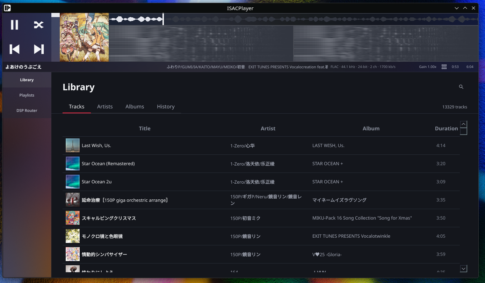
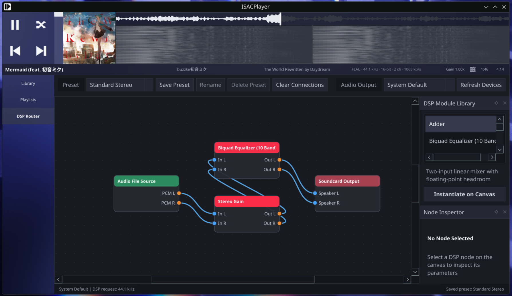

# ISACPlayer

ISACPlayer is a Qt desktop music player for local libraries, playlists, and real-time DSP routing. It combines a library browser with a visual node-based audio graph and loadable audio-format and DSP plugins.

## Interface Preview





## Features

- SQLite-backed music library with background metadata scanning, paginated queries, search, and sorting
- Track, artist, album, and playback-history views, including artwork and album track numbers
- User-managed playlists with track addition, removal, drag reordering, and playlist playback
- Persistent playback queue with sequential, shuffle, repeat-one, and repeat-all modes
- NCM format plugin for metadata and cover extraction, cached playback materialization, and upcoming-track prefetch
- DSP Router with a DAG graph, editable routing presets, selectable output devices, and dockable plugin library and node inspector
- Planar 64-bit floating-point DSP buses, with conversion to interleaved 32-bit float at the device callback boundary
- Independent master Gain at the final output stage; it does not depend on a Gain plugin instance
- DSP plugins: Gain, Mono Gain, Mono Delay, Mono Feedback Delay, Mono Modulated Delay, Stereo Width, Stereo Balance, Adder, ReplayGain, and Biquad Equalizer
- Playback controls for track fade, play/pause fade, and optional track overlap
- Configurable playback history, displayed audio metadata, FFT visualization, smooth scrolling, themes, and selected display effects
- Linux MPRIS integration for desktop media controls and metadata; optional KDE global-menu and compositor integrations when supported by the build/session
- English application interface

The current playback path is stereo. The engine supports graph rates up to 768 kHz, but the actual device rate depends on the selected device, backend, and desktop audio server. The operating system or hardware may resample audio. Multi-device aggregation and arbitrary channel mapping are not implemented, and the float device boundary does not promise bit-perfect output.

## Requirements

- CMake 3.16 or newer
- A C++20 compiler
- Qt 5 or Qt 6 with Widgets and SQL
- Qt DBus on Unix-like non-Apple builds
- TagLib and FFTW3 development packages discoverable through `pkg-config`
- Optional: KDE Window System development package for supported KDE compositor effects

Check that the core `pkg-config` dependencies are visible:

```sh
pkg-config --modversion taglib fftw3
```

## Build

Configure and build from the project root:

```sh
cmake -S . -B build -DCMAKE_BUILD_TYPE=Debug
cmake --build build -j2
```

The application is written to `build/ISACPlayer`. DSP modules are emitted to `build/plugins/`; audio-format modules are emitted to `build/format_plugins/`.

## Arch Linux Package

Build and install a pacman-managed package from a full local checkout:

```sh
cd packaging/arch
makepkg -si
```

Remove it with `sudo pacman -Rns isacplayer`. See [packaging/arch/README.md](packaging/arch/README.md) for the local-package scope and AUR follow-up.

## Run

```sh
./build/ISACPlayer
```

In a build tree, the plugin directories are beside the executable. The Arch package installs them under `/usr/lib/isacplayer/{plugins,format_plugins}` and the application checks that system location as well. A deployment must include both plugin directories; copying only the executable is incomplete.

## Usage

### Library and Playlists

Manage library paths from **Settings > Music Library**, then scan those folders. The Library provides track, artist, album, and history views. Use list headers to sort and the search control to filter the active view. Create and manage playlists from the Playlists page; tracks can be added from library context menus and reordered by dragging.

### DSP Router

Choose an output device and routing preset from the control bar. Add modules from the plugin library, connect node ports on the canvas, and select a node to edit its parameters in the inspector. Custom presets are stored in the application's configuration directory under `dsp-presets/`.

### KDE and MPRIS

On Linux, ISACPlayer exports an MPRIS media-player service over the session D-Bus. KDE Plasma media controls and hardware media keys can control playback and display track metadata. Global-menu export and compositor blur depend on the corresponding KDE support being available in the build and desktop session.

## Plugin Development

The framework-independent DSP SDK is in `plugin_sdk/include/isac/plugin/`. Format plugins use the separate SDK in `format_sdk/include/isac/format/`; they are not DSP nodes and must not run from the audio callback. See [plugins/README.md](plugins/README.md), [format_plugins/README.md](format_plugins/README.md), and the [engineering guide](docs/ENGINEERING.md) for interfaces, deployment, and thread rules.

DSP node `process()` methods run on the real-time audio thread. They must not allocate or free memory, acquire blocking locks, perform I/O, call Qt, or emit signals. Validate parameter values on the control side and publish them to DSP state through lock-free mechanisms.

## Tests

Run the test suite after building:

```sh
ctest --test-dir build --output-on-failure
```

The tests cover audio-engine and node behavior, plugin discovery, patchbay and preset behavior, smooth scrolling, and library persistence, scanning, search, sorting, and playlists.
